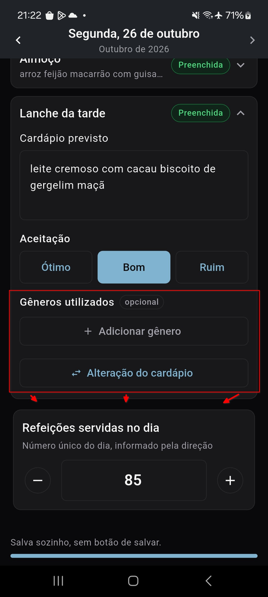
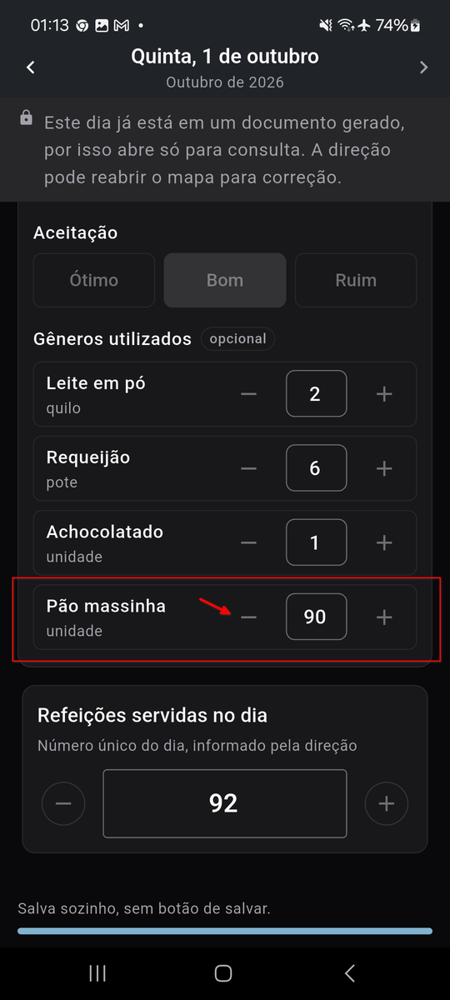
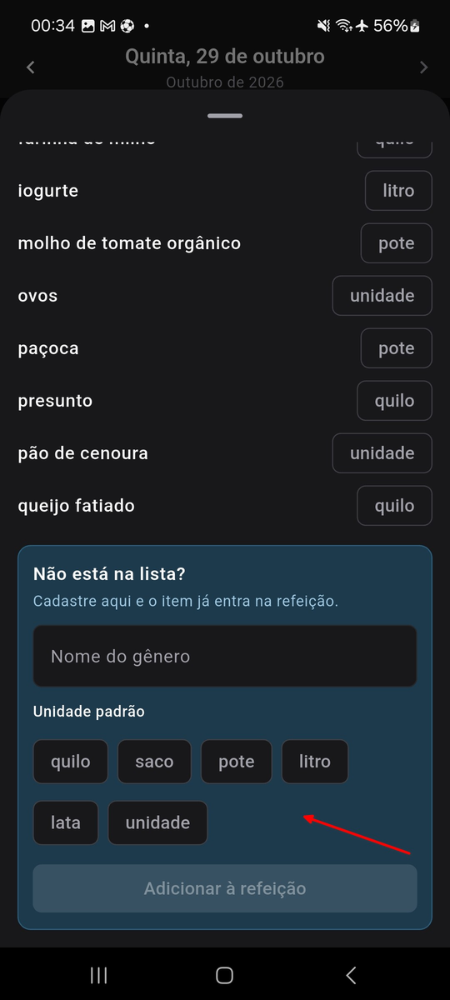
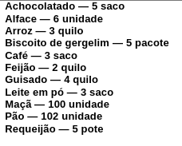
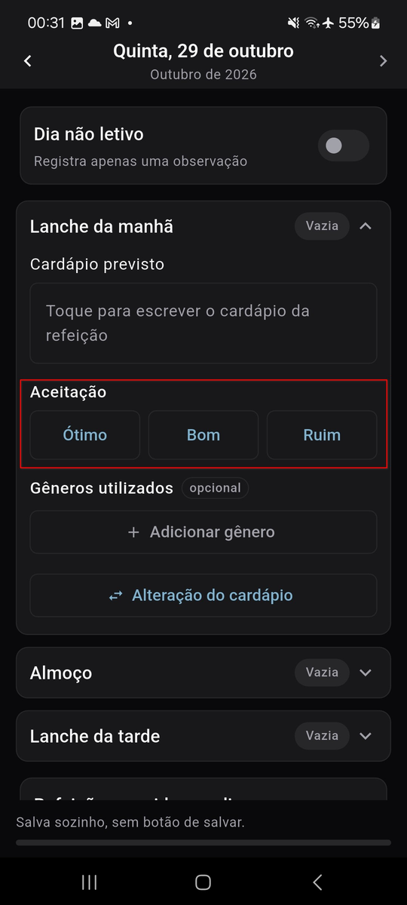
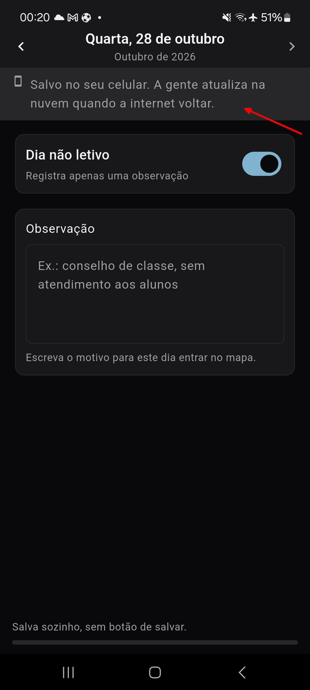
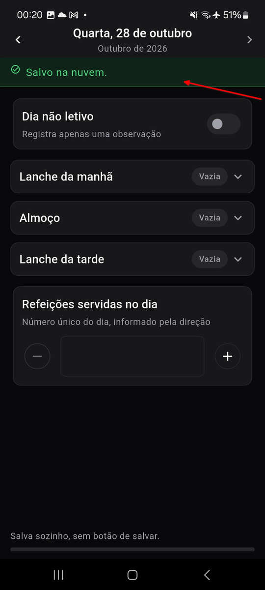

# Laudo de qualidade

> Etapa E7 (refs #180). Os erros que o MAE mostrou antes e durante os testes,
> a correção de cada um e a evidência do erro. Quem testou e o quê está no
> [relato dos testes](relato-dos-testes.md); o sistema já corrigido aparece
> funcionando no vídeo da solução atualizada.

Os erros vieram de três fontes, nesta ordem:

1. **O ensaio geral** (#139), em 08 e 09/10: o caminho inteiro percorrido pelo
   autor no sistema publicado, antes de qualquer testadora.
2. **A [varredura técnica](varredura-tecnica.md)** (#140), em 11/10: os
   registros do aparelho, do navegador e do servidor colhidos no ensaio, os
   avisos do banco, as dependências e o contraste das cores.
3. **Os testes com as pessoas**, de 12 a 30/10: as duas merendeiras no
   aplicativo, a Direção e o Colega na web.

Cada erro virou issue no dia em que apareceu, com a origem no texto. O que
impedia ou atrapalhava o uso foi corrigido na própria etapa; o que era
pedido novo foi para o backlog. Ao todo, 25 achados: 18 corrigidos, 3
corrigidos em parte e justificados no resto, 2 justificados com a causa
explicada e 2 pedidos novos que ficaram como próximos passos. Nenhum erro
ficou aberto.

## Resumo

| # | Erro | Origem | Caminho | Versão |
|---|---|---|---|---|
| #148 | A web publicada não alcançava as funções do servidor | ensaio | corrigido | web |
| #150 | O mês do aplicativo ignorava os dias guardados no celular | ensaio | corrigido | 0.1.2 |
| #151 | O registro do dia não tinha as setas de dia anterior e próximo | ensaio | corrigido | 0.1.2 |
| #152 | O selo *Reaberto* não aparecia no aplicativo | ensaio | corrigido | 0.1.2 |
| #153 | Os selos *Reaberto* e *Preenchido* se espremiam na web | ensaio | corrigido | web |
| #154 | As assinaturas do documento se separavam do último dia | ensaio | corrigido | servidor |
| #147 | O Android barrava o APK de desenvolvedor não verificado | ensaio | corrigido | conta verificada |
| #164 | O aplicativo aberto sem internet caía no login | conferência da 0.1.2 | corrigido | 0.1.3 |
| #140 | APK de 64 MB | varredura | corrigido | 0.1.2 |
| #140 | Backup do Android devolvia a sessão sem a chave | varredura | corrigido | 0.1.2 |
| #140 | Avisos de segurança e desempenho do banco | varredura | corrigido ou justificado | banco |
| #140 | Dependências com vulnerabilidade | varredura | corrigido ou justificado | web |
| #140 | Cores abaixo do contraste mínimo | varredura | corrigido ou justificado | web e 0.1.2 |
| #140 | Mensagem que culpava a internet num erro de configuração | varredura | justificado | — |
| #140 | Erros tratados sem registro | varredura | justificado | — |
| #171 | O código do primeiro acesso não tinha onde ser digitado | Merendeira 2 | corrigido | 0.1.4 |
| #172 | Gêneros e alteração do cardápio presos a cada refeição | Merendeira 1 | corrigido | 0.1.4 |
| #173 | Gêneros adicionados um por um | Merendeira 2 | corrigido | 0.1.5 |
| #174 | Tirar um gênero com quantidade alta | Merendeira 2 | corrigido | 0.1.5 |
| #175 | Unidades por extenso | Merendeira 1 | corrigido | 0.1.5 |
| #176 | Quantidade depois do gênero no documento | Merendeira 1 | corrigido | 0.1.5 |
| #177 | Aceitação na ordem Ótimo, Bom, Ruim | Merendeira 1 | corrigido | 0.1.5 |
| #178 | Aviso de salvamento que empurrava a tela | Merendeira 2 | corrigido | 0.1.5 |
| #169 | Entrar com a digital | Merendeira 2 | próximo passo | — |
| #170 | Documentos gerados na web para a direção | Colega | próximo passo | — |

## Os testes com as pessoas

As correções chegaram às merendeiras em duas versões do aplicativo: a 0.1.4
(28/10), que mudou o formato do dia, e a 0.1.5 (29/10), com o resto. As duas
atualizaram pelo próprio aplicativo e aprovaram as correções em 30/10.

### O código do primeiro acesso (#171, erro)

*Merendeira 2, 12/10.* A conta nasce sem senha, e o e-mail da criação do
acesso traz um link (para a web) e um código de 6 dígitos (para o
aplicativo). Só que o aplicativo só aceitava o código depois de ela pedir
"Esqueci minha senha", e esse pedido manda **outro** código. Ela entrou pelo
caminho da recuperação de senha, que ninguém adivinharia sozinho.

**Correção:** o "Esqueci minha senha" ganhou o caminho "Já tenho um código",
que aceita o código do e-mail de primeiro acesso, e o e-mail passou a dizer
onde tocar em cada caso.

### Gêneros e alteração do cardápio do dia, e não de cada refeição (#172)

*Merendeira 1, 23/10.* Ela lançava todos os gêneros do dia numa refeição só,
deixando as outras duas sem gênero, e pediu para continuar assim. Separar por
refeição foi uma inferência do projeto: o documento oficial reúne os gêneros
do dia numa coluna só.

**Correção:** os gêneros utilizados e a alteração do cardápio saíram das três
refeições e viraram um cartão próprio do dia. Os registros que já existiam
foram juntados por dia, somando os gêneros repetidos. A mudança também
resolveu quando um dia está completo: sem gênero nenhum, o dia aparece como
pendente.

### Gêneros adicionados um por um (#173)

*Merendeira 2, 23/10.* Cada gênero do dia pedia o mesmo caminho: "Adicionar
gênero → escolher → voltar", repetido item por item. Ela pediu para marcar
vários gêneros na lista e adicionar todos de uma vez.

**Correção:** na lista de gêneros, um toque marca o item, e um botão adiciona
todos os marcados de uma vez.

### Tirar um gênero com quantidade alta (#174)

*Merendeira 2, 23/10.* Um pão lançado no lugar errado com 120 unidades só
saía apertando "−" até chegar a 1.

**Correção:** arrastar o gênero para o lado tira o item na hora, com a opção
de desfazer.

### Unidades por extenso (#175)

*Merendeira 1, 23/10.* As sugestões de unidade eram quilo, saco, pote,
litro, lata e unidade. Ela prefere as que vêm na nota fiscal do fornecedor,
"kg" e "un", que são as que elas usam para conferir o que recebem.

**Correção:** as sugestões passaram a ser só "kg" e "un", e os gêneros já
cadastrados foram convertidos. Qualquer outra unidade continua podendo ser
digitada no catálogo.

### Quantidade depois do gênero no documento (#176)

*Merendeira 1, 23/10.* O documento gerado listava "Arroz — 3 quilo", com o
plural errado em "6 unidade".

**Correção:** o documento passou a listar a quantidade primeiro, "3 kg —
Arroz", o que também acabou com o plural errado.

### Aceitação na ordem Ótimo, Bom, Ruim (#177)

*Merendeira 1, 23/10.* Ela pediu a ordem inversa, que para ela faz mais
sentido.

**Correção:** Ruim, Bom, Ótimo, no aplicativo, na web e no painel da direção.

### O aviso de salvamento que empurrava a tela (#178)

*Merendeira 2, 23/10.* O aviso no alto do dia ("Salvo no seu celular…",
"Salvo na nuvem.") aparecia e sumia enquanto ela digitava, e a tela inteira
descia e subia junto.

 

**Correção:** no aplicativo, os avisos da nuvem viraram uma mensagem por
cima da tela, embaixo, que some sozinha e não mexe no conteúdo; na web, um
aviso no canto da tela. Só o aviso de dia trancado continua como faixa,
porque ele não muda e o dia não é editável.

### Pedidos novos

Dois pedidos não eram erro: são funções que o produto não prometia. Ficaram
registrados como próximos passos, com a origem declarada.

- **Entrar com a digital** (#169), pedido da Merendeira 2 depois de criar a
  senha.
- **Documentos gerados na web para a direção** (#170), pergunta do Colega.
  Hoje os documentos são das merendeiras; a tela já existe para elas e
  serviria à direção quase sem mudança.

## O ensaio geral

O ensaio passou pelo caminho inteiro no sistema publicado, com os registros
do aparelho, do navegador e do servidor lidos no mesmo dia. A evidência de
cada erro está na issue, com o registro que o mostrou.

- **A web publicada não alcançava as funções do servidor (#148).** Criar o
  acesso de uma merendeira e gerar o documento falhavam na web publicada,
  mas não no ambiente local. O servidor só liberava parte dos cabeçalhos que
  a biblioteca do Supabase manda, e o navegador barrava a resposta (CORS).
  **Correção:** os cabeçalhos passaram a vir da própria biblioteca.
- **O mês do aplicativo ignorava os dias guardados no celular (#150).** Um
  dia registrado sem internet aparecia como vazio na visão do mês até subir
  para a nuvem. **Correção:** o mês junta o que está na nuvem com o que espera
  no celular, e diz quantos dias ainda não subiram.
- **Sem as setas de dia anterior e próximo (#151).** O desenho da E3 tinha as
  setas no alto do registro do dia, e o aplicativo não. **Correção:** as setas
  entraram, com o mês embaixo da data.
- **O selo *Reaberto* não aparecia no aplicativo (#152).** A web mostrava
  quais dias a direção tinha reaberto; o aplicativo não. **Correção:** o selo
  aparece no mês do aplicativo.
- **Os selos se espremiam na web (#153).** *Reaberto* e *Preenchido* lado a
  lado apertavam o cardápio do dia. **Correção:** os selos ficam um sobre o
  outro, na web e no aplicativo.
- **As assinaturas do documento se separavam do último dia (#154).** No
  documento gerado, o rodapé das assinaturas caía sozinho na página seguinte,
  e o editor do Word Online desalinhava as colunas. **Correção:** as
  assinaturas viraram uma tabela sem borda, presa ao último dia.
- **O Android barrava o aplicativo (#147).** Desde 30/09/2026, aparelhos
  certificados no Brasil só instalam aplicativos de desenvolvedor verificado.
  **Correção:** a conta de desenvolvedor foi verificada e o pacote
  registrado; a atualização pelo próprio aplicativo foi conferida no aparelho
  de teste na 0.1.2, e a Merendeira 2 instalou sem aviso.
- **O aplicativo aberto sem internet caía no login (#164).** Achado ao
  conferir a 0.1.2, antes das testadoras: a sessão ficava no aparelho, mas o
  perfil só vinha da rede. **Correção:** o perfil fica guardado no aparelho e
  é relido quando a rede volta. Saiu na 0.1.3, a versão com que as
  merendeiras começaram.

## A varredura técnica

Os achados que não atrapalharam o uso no ensaio, mais o que só uma
verificação de código e de banco encontra. O detalhe de cada um, com os
números, está na [varredura técnica](varredura-tecnica.md).

- **APK de 64 MB.** Levava o código de três arquiteturas. **Corrigido:** só
  a dos aparelhos delas; a 0.1.5 tem 23 MB.
- **A sessão que o backup devolvia sem a chave.** O backup automático do
  Android restaurava a sessão cifrada sem a chave que a abre. **Corrigido:**
  o backup foi desligado; o aparelho novo reconstrói tudo pela nuvem.
- **15 avisos de segurança e 15 de desempenho do Supabase.** **Corrigidos**
  os que davam alguma margem (função sem caminho de busca fixo, função
  privilegiada executável sem login); **justificados** os demais, cada um com
  o motivo, e um teste do banco impede que os corrigidos voltem.
- **16 dependências vulneráveis na web**, todas em ferramentas de
  desenvolvimento, nenhuma no que o navegador baixa. **Corrigidas** 10;
  **justificadas** as 7 de uma ferramenta usada só à mão.
- **Quatro pares de cor abaixo do contraste mínimo (WCAG AA).** **Corrigidos**
  os três que são texto, na web, no aplicativo e no desenho das telas;
  **justificado** o quarto, que é área de cor num gráfico, com o número ao
  lado.
- **A mensagem que culpava a internet.** No erro de CORS, a web disse que
  "quase sempre é a internet". **Justificado:** para o navegador, os dois
  casos são idênticos, e o gesto pedido (tentar de novo) serve aos dois.
- **Erros tratados sem registro.** **Justificado:** nenhum atrapalhou o
  diagnóstico no ensaio, e cada um é um recuo escolhido, com o motivo ao
  lado.

## O que os testes automatizados garantem

Os erros acima foram achados por pessoas e pelo ensaio. O que impede que
voltem é a integração contínua: cada mudança roda as suítes abaixo no GitHub
Actions antes de entrar na `main`, e as correções desta etapa entraram com
os seus testes.

| Suíte | O que cobre | Tamanho |
|---|---|---|
| Banco (pgTAP) | regras de acesso por perfil, gravação do dia, bloqueio e reabertura, versão mínima, avisos do Supabase | 181 verificações |
| Aplicativo (Flutter) | unidade e widget: telas, banco local, fila de envio, atualização | 316 testes |
| Web (Vitest) | unidade e componente | 327 testes |
| Ponta a ponta (Playwright) | o caminho crítico da merendeira, do login ao documento gerado, aberto e conferido por dentro | 1 cenário |

O caminho crítico no aplicativo é conferido à mão no aparelho a cada release,
como decidido na [E6](../06-app/decisoes-tecnicas.md).
